# Job Search Ledger

A friendly, local job search tracker built with Streamlit. Point it at a spreadsheet of your applications and it gives you a pipeline, a daily heat map, pay ranges against your target, a "needs action" list, and a weekly work search log, export-ready for any job search reporting (state workforce, career coach, or your own records).

**What you need:** a CSV of your applications (or start from scratch in the app).

Everything stays on your computer. Your status edits and notes go in a small local database. The CSV is only written when you add an application in the app.

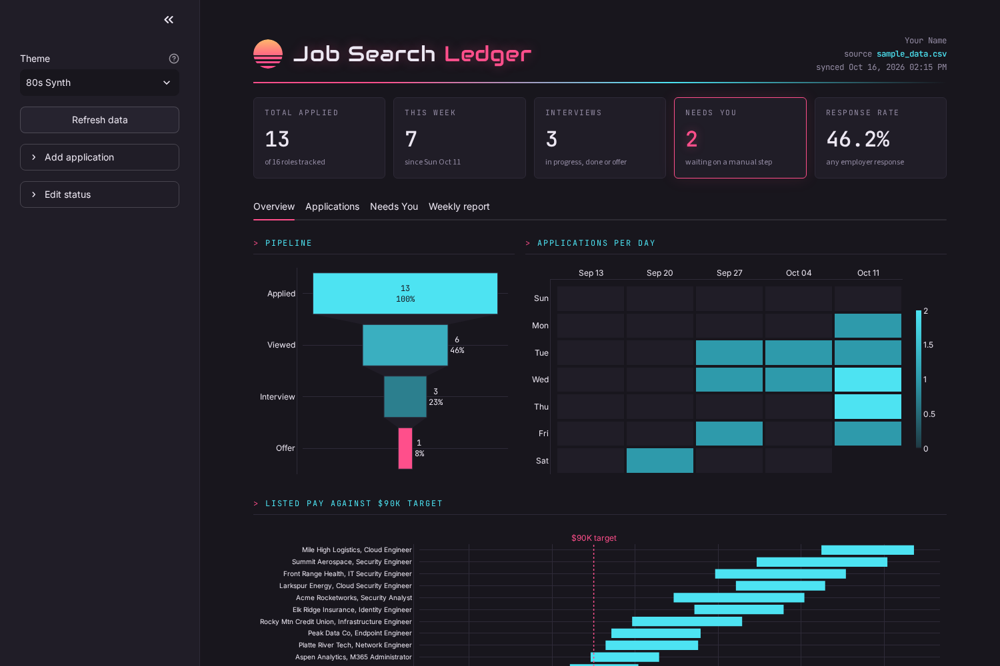

## Columns

Only three columns are required. Everything else is optional, blanks are fine, and extra columns are ignored.

| Column | Required | Notes |
| --- | --- | --- |
| Date Applied | Required | Any common date format, for example `2026-10-16` |
| Company | Required | Rows with no company are skipped |
| Position | Required | Job title |
| Status | Optional | Defaults to Applied. Any status starting with "Needs" shows up in the Needs tab |
| Pay Listed | Optional | Text like `$85K-$100K` or `$40/hr` (hourly is annualized) |
| Location/Remote | Optional | |
| Source | Optional | Where you found it, for example LinkedIn |
| Apply Method/ATS | Optional | Used in the weekly log |
| Confirmation | Optional | |
| URL | Optional | Link to the posting |
| Notes | Optional | |
| Evidence | Optional | |

Minimal data still works: a CSV with just Date Applied, Company and Position fills every chart it can, and the pay chart simply stays empty until you add pay. `templates/blank_tracker.csv` has the full header row, and `sample_data.csv` shows filled in fake examples.

## First run

If no CSV is set up, or the configured file is missing or empty, the app shows a welcome screen with two choices:

* **Import my spreadsheet**: upload your CSV and it is saved to the configured path.
* **Start from scratch**: creates a blank tracker with every column (at `data/job_applications.csv` unless you set a path).

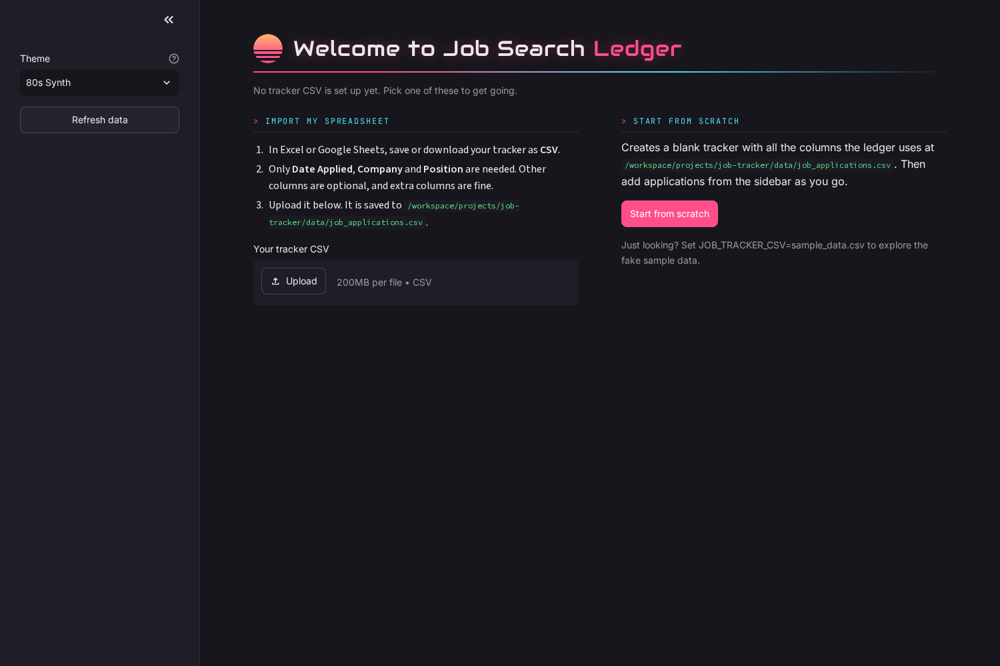

## Adding and updating applications

Open **Add application** in the sidebar. Company, Position and Date applied (default today) are required. Job URL, pay min and max, location, source, status (default Applied) and notes are optional. Submitting appends a row to your CSV. If your CSV is missing some standard columns, they are added as blank columns.

**Edit status** in the sidebar changes the status of any existing row in two clicks. You can also edit Status, My Notes and Contact inline on the Applications tab. Status edits are saved in the local database, not the CSV.

## Quick start

You need Python 3.11 or newer from [python.org](https://www.python.org/downloads/).

**Windows**

1. When installing Python, tick "Add python.exe to PATH".
2. Download or clone this repo to a folder you will keep, for example `C:\Apps\job-search-ledger`.
3. Double-click `launch.bat`. The first run sets everything up (about a minute), then the ledger opens in its own window.
4. Optional desktop shortcut: right-click `create_shortcut.ps1` and choose "Run with PowerShell".

**Mac (or Linux)**

```bash
cd job-search-ledger
python3 -m venv .venv
.venv/bin/pip install -r requirements.txt
.venv/bin/streamlit run app.py
```

Then open http://localhost:8501. You will see the welcome screen. To look around with fake data first, start it with `JOB_TRACKER_CSV=sample_data.csv`.

## Use your own CSV

1. Save your tracker as a CSV with at least Date Applied, Company and Position (see [Columns](#columns)). Or use the Import button on the welcome screen.
2. Copy `settings.example.json` to `settings.json` and edit it:

   ```json
   {
     "csv": "~/Documents/job_applications.csv",
     "name": "Your Name",
     "target": 90000,
     "theme": "80s Synth"
   }
   ```

   On Windows a path like `%USERPROFILE%\\Documents\\job_applications.csv` works too.
3. Start the app again. It reloads the CSV whenever the file changes, and the sidebar has a Refresh button.

Tips: any status starting with "Needs" (like "Needs action") shows up in the Needs tab. `settings.json` and the database are git ignored, so your real data never ends up in the repo. If your CSV lives in OneDrive, keep the database (`"db"`) outside OneDrive.

Every setting can also be set with an environment variable: `JOB_TRACKER_CSV`, `JOB_TRACKER_DB`, `JOB_TRACKER_TARGET`, `JOB_TRACKER_THEME`, `JOB_TRACKER_NAME`.

## Themes

Pick a theme in the sidebar and it is remembered next time. Preview one with `?theme=Y2K` in the URL.

| | | |
| --- | --- | --- |
| 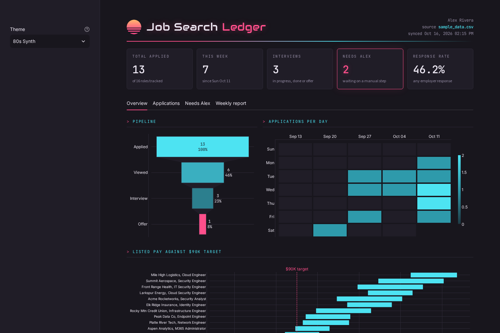 **80s Synth** (default) | 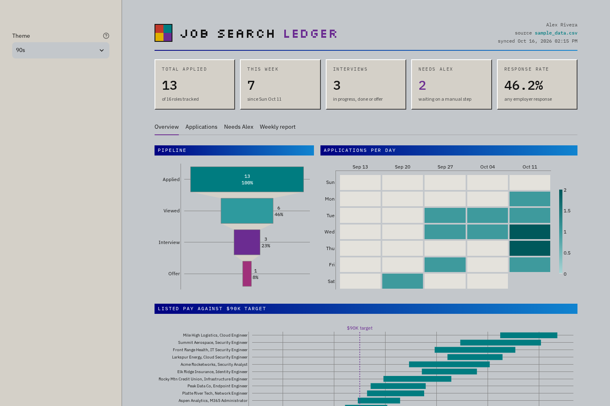 **90s** | 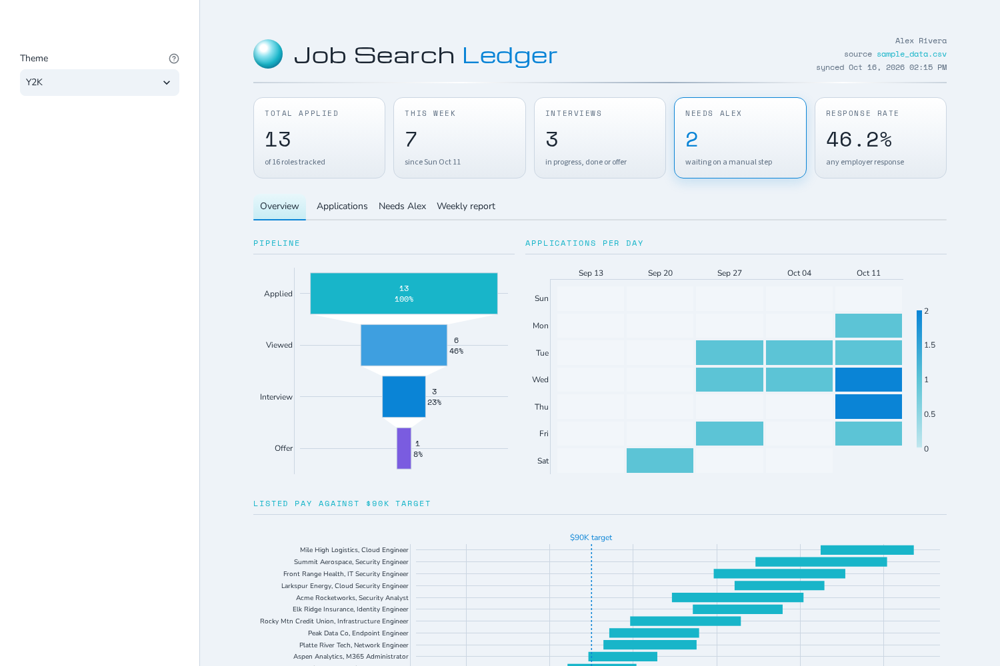 **Y2K** |
| 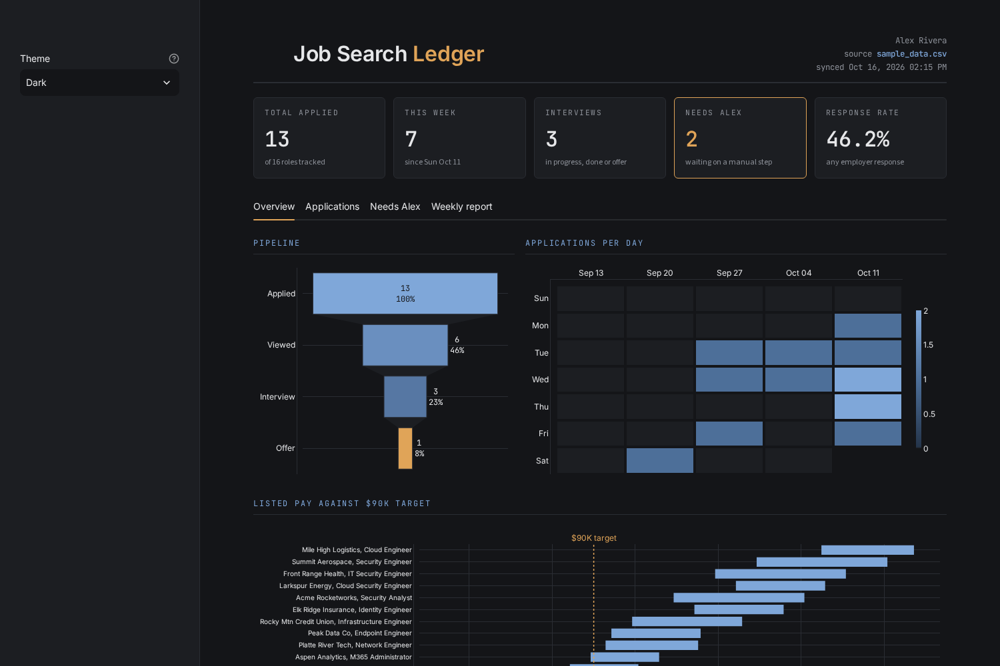 **Dark** | 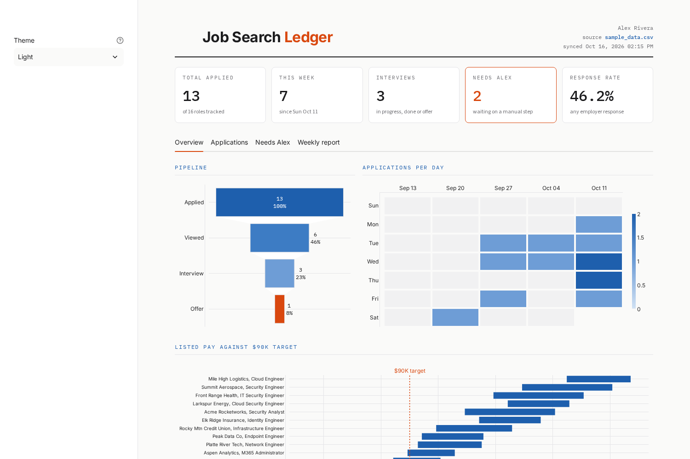 **Light** | 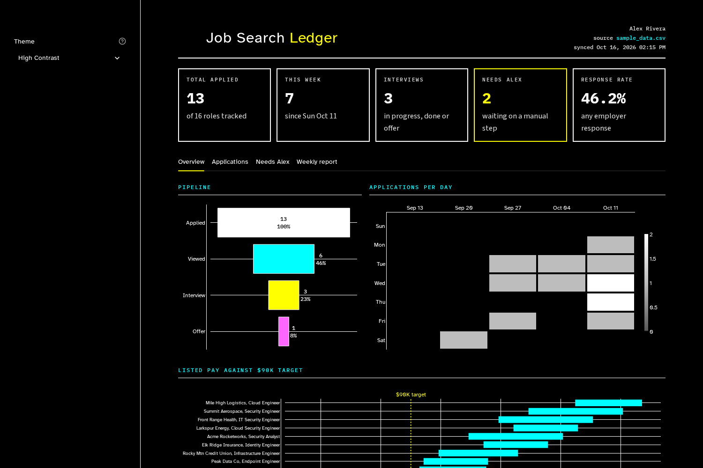 **High Contrast** |
| 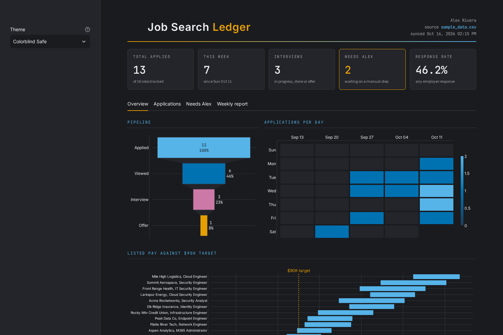 **Colorblind Safe** | | |

Pay bars below your target are hatched as well as colored, so no theme relies on color alone. To add your own, copy an entry in `themes.py`, rename it and change the colors.

## More screenshots

| Applications | Needs | Weekly report | Add application |
| --- | --- | --- | --- |
| 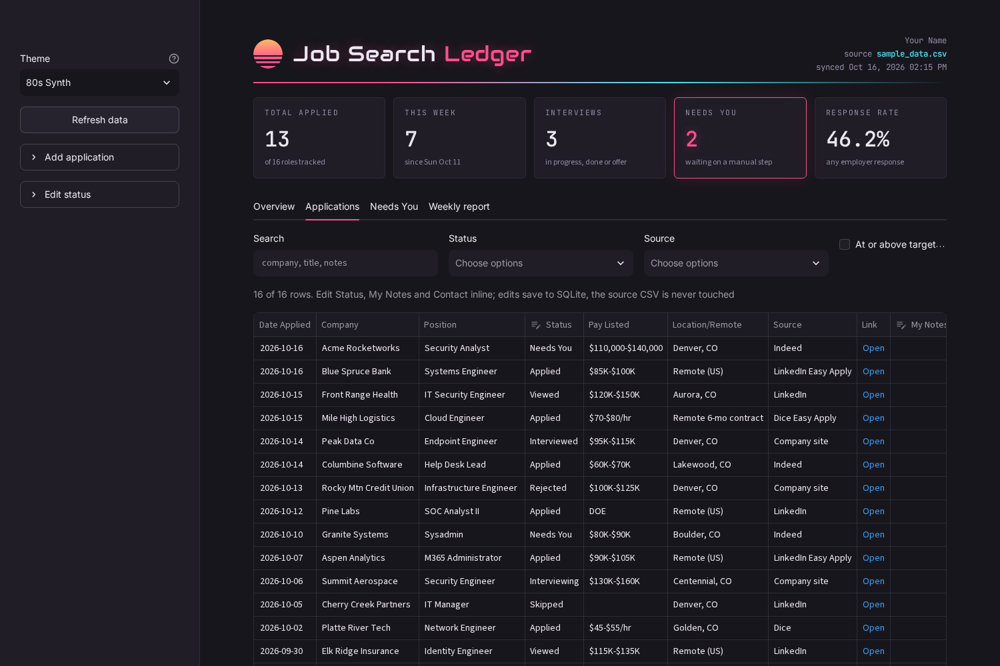 | 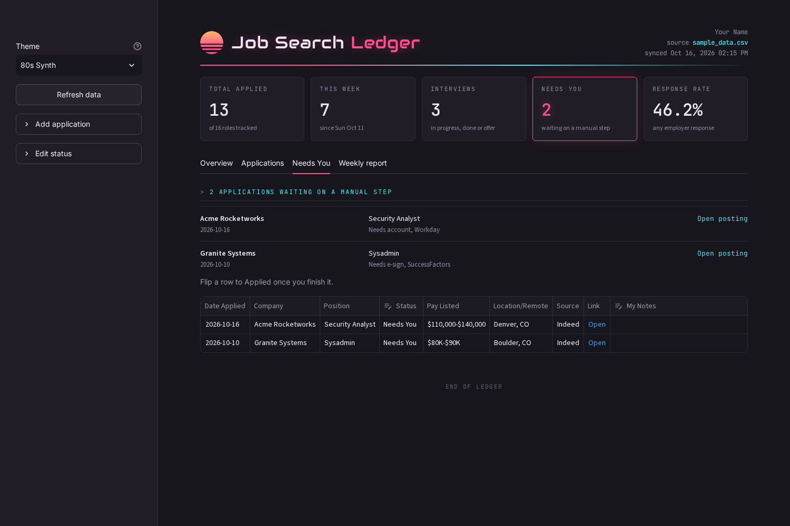 | 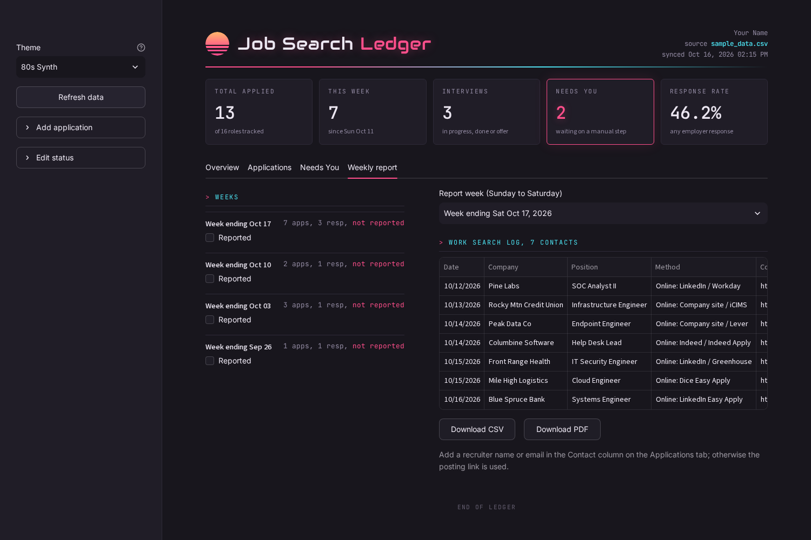 | 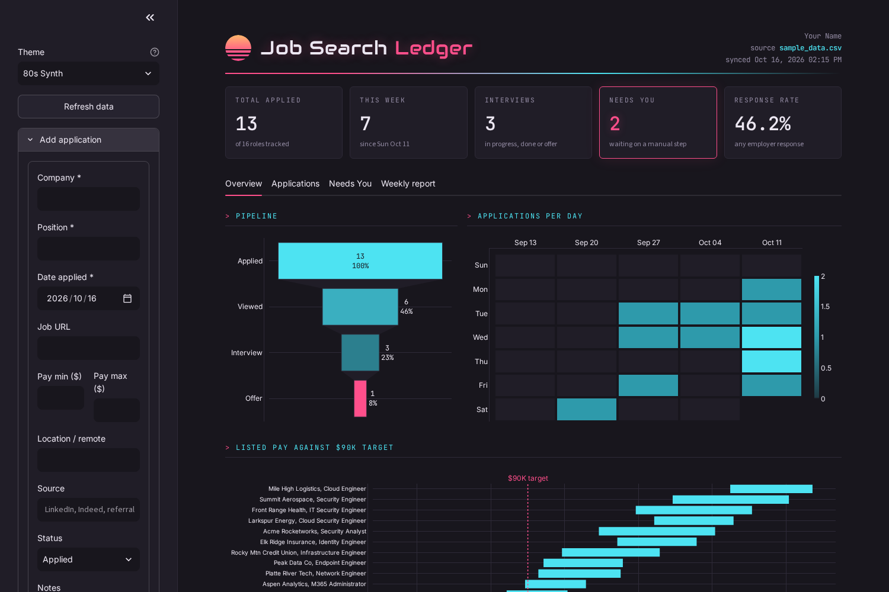 |

All screenshots use the fake `sample_data.csv`. Regenerate them with Playwright against an app started with `JOB_TRACKER_CSV=sample_data.csv`: `python shoot.py 8501 ""` and `python shoot_themes.py 8501`.

## License

MIT. See [LICENSE](LICENSE).

---

Built by Colin Lundholm ([github.com/gitColinX](https://github.com/gitColinX)).
